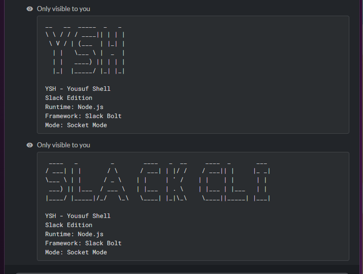
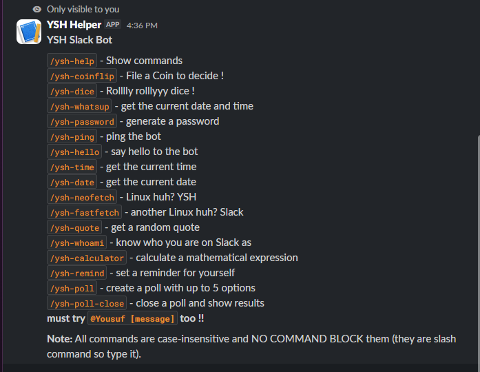
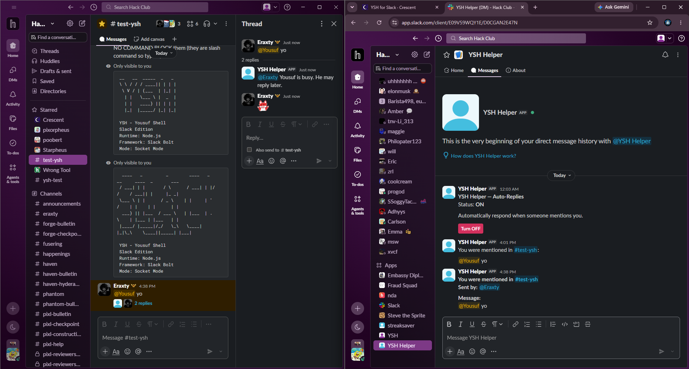
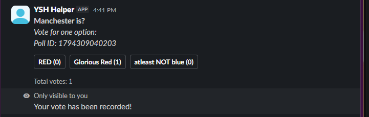

# YSH Helper 

A Slack bot with 17 commands and built with Node.js and Slack Bolt. It includes utility commands, interactive polls, reminders, and an automatic mention-reply system.
- Start with `/ysh-help` and try `/ysh-fastfetch` & `/ysh-neofetch` too! 

## Features 

- **Utility commands** - coin flips, dice rolls, password generation, calculator, quotes, and more.
- **User information** - `/ysh-whoami` displays information about the person using it.
- **System information** - `/ysh-neofetch` and `/ysh-fastfetch`.
- **Reminders** - Set a reminder and receive a DM when it's due.
- **Interactive polls** - Create polls, vote using Slack buttons, and close polls.
- **Mention notifications** - When someone mentions Yousuf in a channel the bot is in, it replies in the thread and sends a DM containing the channel, sender, and original message.
- **Auto-reply controls** - Enable or disable automatic replies using buttons in the bot's DM. The setting is saved between restarts.

## Commands (17 rn) 

`/ysh-help` - Show available commands 
`/ysh-coinflip` - Flip a coin to decide 
`/ysh-dice` - Roll a dice for fun 
`/ysh-whatsup` - Get what you are upto 
`/ysh-password` - Generate a password 
`/ysh-ping` - Check bot response 
`/ysh-hello` - Say hello 
`/ysh-time` - Get the current time 
`/ysh-date` - Get the current date 
`/ysh-neofetch` - Display system information 
`/ysh-fastfetch` - Display system information 
`/ysh-quote` - Get a random quote 
`/ysh-whoami` - Display your Slack user information 
`/ysh-calculator` - Evaluate a mathematical expression 
`/ysh-remind` - Set a personal reminder 
`/ysh-poll` - Create an interactive poll 
`/ysh-poll` -close - Close a poll 

## Mention System 
- quality feature ! -

- `@Yousuf [message]` in the channel `#test-ysh` to test. 

The bot monitors messages in channels where it has been added.

When another user mentions Yousuf:
1. The bot replies in the original message's thread.
2. Yousuf receives a direct message.
3. The notification includes who sent the message, which channel it came from, and the original message.

Automatic replies can be switched on or off through the control panel in the bot's DM. The selected setting persists after a restart.

## Polls and Reminders 

Polls use interactive Slack buttons, allowing users to vote directly from the pool message. The message updates as votes are recorded.

Reminders send a direct message when their timer expires.

## Tech Stack 

- Node.js
- JavaScript
- Slack Bolt
- JSOn 
- Slack Socket Mode 
- Nest Hack Club 

## Project Files 

- index.js - Bot initialization, slash commands, message events, and auto-reply system.
- poll.js - Poll creation, voting, and closing logic.
- package.json - Project dependencies and metadata.

## AI Help !? - yah but - 

I used AI to help me add a better polling system to YSH Helper Slack Bot because what I built myself was lil broken without any closing and not a good vote counting system, to debug the auto reply and DM system as what I built wasnt working. - THese MUCH AI sadly 
